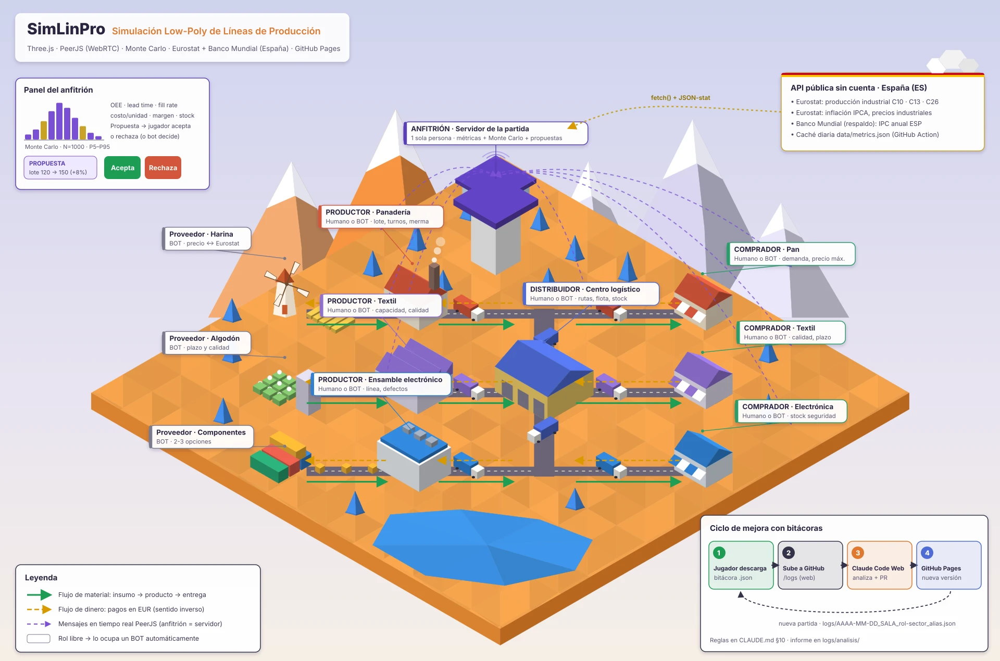

# SimLinPro · Simulación low-poly de líneas de producción

Simulación en **tiempo real** de una cadena de suministro con tres sectores (panadería, textil y ensamble electrónico), representada con una escena 3D low-poly isométrica. Pensada para una clase de 45–60 min: el anfitrión proyecta la escena y hasta 9 jugadores entran desde el móvil o el portátil.

**Jugar:** https://edgar-rodriguez-art.github.io/gh1611-simLinPro/



```
Proveedor (BOT) ──insumos──▶ Productor ──lotes──▶ Distribuidor ──entregas──▶ Comprador
        ◀──────── pagos EUR ───────── ◀──── pagos EUR ──── ◀──── pagos EUR ────
                    ▲ propuestas de mejora (Monte Carlo) del ANFITRIÓN ▲
```

## Cómo jugar

1. **Anfitrión** (docente): «Crear sala». Su navegador es el servidor de la partida (PeerJS/WebRTC). Muestra un código de 6 caracteres y un QR.
2. **Jugadores**: «Unirse con código» (o escanear el QR), escribir un alias y elegir puesto: productor, distribuidor o comprador de un sector. Los puestos libres los juega un **BOT**.
3. El anfitrión pulsa **Iniciar partida**. 1 día simulado = 60 s (×0,5, ×1, ×2, ×4). Por defecto, 40 días.
4. Cada jugador ajusta sus parámetros (turnos, lote, precio, camiones, política (s, Q), cesta, stock de seguridad…) y ve sus KPI.
5. El anfitrión ejecuta **Monte Carlo** (14 días, N réplicas) sobre un puesto, ve el ranking y el histograma y **envía la propuesta que elija**. El jugador la acepta o la rechaza (90 s).
6. Al terminar, cada uno pulsa **Descargar bitácora** y la sube a [`logs/`](logs/README.md).

**Modo demo local:** todo en un dispositivo, sin red; tú juegas un puesto y ves también el panel del anfitrión.

Si la red del centro bloquea WebRTC (UDP), conecta todos los dispositivos al punto de acceso de un móvil.

## Datos reales de España

Eurostat (`sts_inpr_m` C10/C13/C26 y `prc_hicp_manr`) → caché diaria `data/metrics.json` (GitHub Action) → Banco Mundial → valores por defecto. El panel del anfitrión muestra la fuente y la fecha de cada dato.

## Desarrollo

```bash
npm ci
npm run dev       # http://localhost:5173/gh1611-simLinPro/
npm test          # Vitest: motor, KPI, Monte Carlo, protocolo, red, bitácoras, replay
npm run lint
npm run build
node scripts/fetch-metrics.mjs --fixtures tests/fixtures --out /tmp/m.json   # prueba sin red
node scripts/analyze-logs.mjs                                                # bitácoras nuevas
```

Estructura, reglas y procedimiento de mejora con bitácoras: [`CLAUDE.md`](CLAUDE.md). Mensajes de red: [`docs/protocolo.md`](docs/protocolo.md). Configuración manual de GitHub: [`docs/CONFIGURACION_GITHUB.md`](docs/CONFIGURACION_GITHUB.md).

Stack: Vite + JavaScript (ES modules), Three.js, PeerJS (PeerJS Cloud + STUN de Google), uPlot, Web Workers y Vitest. Sin backend propio.
